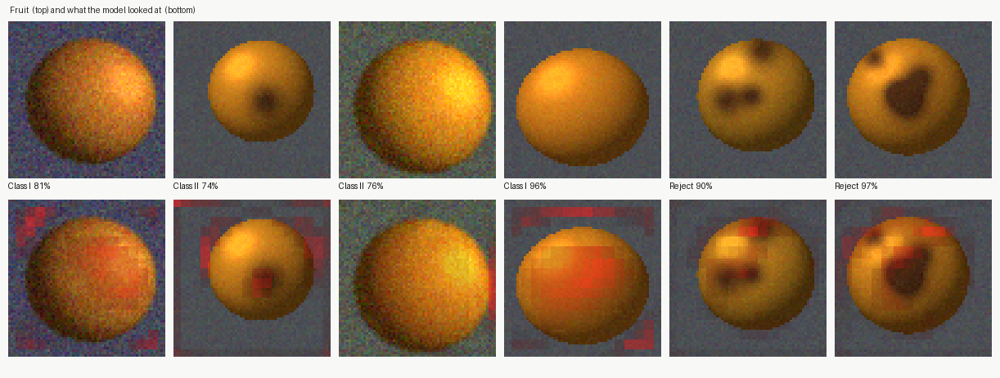
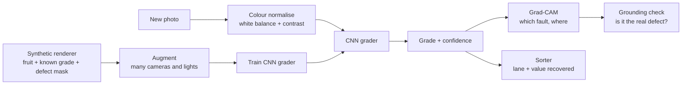
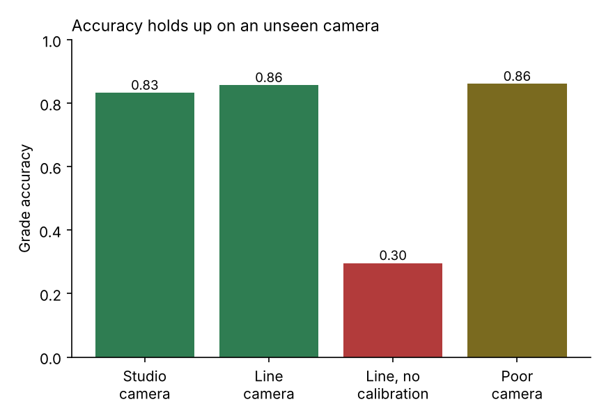
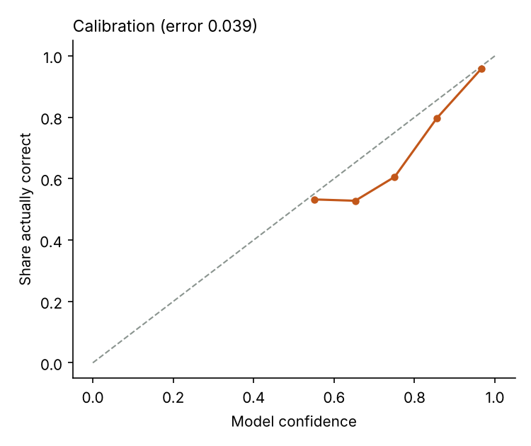
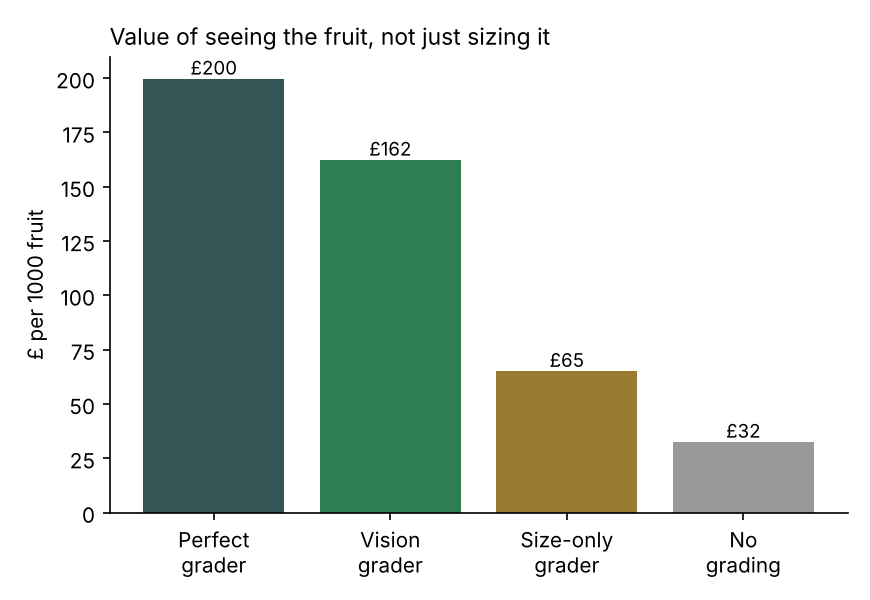

# FreshGrade

**Grade fruit against a retailer specification from a single photo, trained on
synthetic images alone, and show the operator why.** A small PyTorch model reads
a picture of a piece of fruit, grades it Class I, Class II or Reject, highlights
the fault it reacted to, and turns the grade into a pick-and-place sorting
decision. Every training image is rendered, so the correct grade is known for
free and no fruit was ever hand labelled.



## Why this project

A packhouse grades fruit against a written standard agreed with the retailer:
too bruised, too small, off-colour or misshapen, and it drops a grade or comes
off the line. Doing this by eye is slow and inconsistent. A camera and a model
can do it on a moving belt, but only if two hard things are true: the model has
to work under a real camera and real lighting, not just the setup it was built
on, and staff have to be able to see why it made a call. FreshGrade is built
around those two problems.

It is a self-contained demonstration of the pipeline a fruit-grading project
needs: render synthetic fruit with known grades, train a grader on them, show
it holds up on an unseen camera, explain each decision, and put a money value
on getting the grade right.

## How it works



The grade comes from four things the specification cares about: surface defect,
size, colour and shape. The worst one decides the grade, which is how a real
spec works: one bad bruise is enough.

## Training on pictures, grading with none hand-labelled

The renderer (`fg/render.py`) draws each fruit as a shaded sphere with a chosen
size, skin colour, surface bruises and shape, on a conveyor background. Because
those numbers are chosen, the true grade (`fg/spec.py`) and a pixel-accurate
defect mask come out automatically. That is the whole point of synthetic data:
the labels are free and exact.

The single most important trick for making synthetic training work on a real
camera is **domain randomisation**. The model trains on fruit lit from many
directions, through many simulated cameras (colour casts, noise, focus). A real
camera then looks like just one more variation it has already seen. The
evaluation below measures exactly how much this is worth.

## Results

Trained on 8,000 synthetic fruit under randomised cameras and lighting
(augmented to 16,000), then tested on 2,500 fruit from fixed cameras the model
never saw as a fixed setting. About 52% of fruit are Class I, 28% Class II and
19% Reject.

| Test camera (unseen) | Grade accuracy | Macro F1 |
|---|---|---|
| Studio camera | 0.833 | 0.799 |
| Line camera (different, with colour normalisation) | 0.857 | 0.837 |
| Line camera, **without** colour normalisation | 0.296 | 0.287 |
| Poor-quality line camera | 0.861 | 0.832 |



**What this shows**

- **Synthetic training transfers, but only with the right preparation.** The
  grader scores about the same on a different camera (0.857) as on the one its
  images were rendered for (0.833). Take away the colour normalisation step and
  accuracy on that camera falls to 0.296: the model was leaning on the camera's
  colour cast. This is the difference between a model that works on the line and
  one that only works in the lab.
- **The mistakes are the safe kind.** Almost no Class I fruit is called Reject
  and almost no Reject is called Class I; the errors sit between neighbouring
  grades, on genuinely borderline fruit near a threshold.
- **It is honest about the number.** Accuracy is about 0.83 to 0.86, not the
  95% a brief might hope for. Much of the gap is fruit a hair either side of a
  grade boundary, which is ambiguous from a picture by design. A real build on
  real fruit would tune the thresholds with the packhouse and measure against
  graders, not a simulation.

### The grades mean what they say



The confidence numbers are calibrated with temperature scaling, so of the fruit
graded at 80% confidence about 80% are really that grade (calibration error
0.039). A grader that knows when it is unsure can send only the doubtful fruit
to a person.

### Catching the fruit that matters

Missing a bad fruit is the costly error. Treating "not Class I" as the thing to
catch, the grader finds 83% of them at 96% precision, and catches 64% of
outright Rejects. Crucially, it almost never makes the dangerous mistake: on the
studio test set, no Class I fruit was called a Reject, and only a handful of
Rejects were called Class I. The errors that remain are between neighbouring
grades.

### Does it look at the real fault?


A grade on its own is hard to trust. Grad-CAM (`fg/explain.py`) turns the model's
last convolution layer into a heat map over the fruit, so the operator sees what
it reacted to. On synthetic fruit we also know the true defect mask, so we can
check something a label cannot tell us: when the model downgrades a fruit for a
surface defect, does it look at the real bruise? It puts about **2.9 times more
heat on the real bruise than on the rest of the fruit** (median), does so for
87% of defect fruit, and its single hottest point lands on the bruise 56% of the
time. The heat map is coarse, so it points rather than outlines, but it points
at the right thing. In production the mask is gone, so this grounding number,
measured offline, is the evidence the heat map can be trusted.

### What better grading is worth



A grade becomes a sorting decision: premium pack, second-grade pack, or off the
line, with low-confidence fruit sent for a human check (`fg/sort.py`). Putting a
simple price on each lane and a penalty on overselling a poor fruit, the vision
grader earns about £162 per 1,000 fruit against £65 for a size-only mechanical
grader (which cannot see bruises, colour or shape) and £200 for a perfect
grader. That is about £97 more per 1,000 fruit than sizing alone, and 78% of the
best possible value. That gap is, in plain terms, the value of being able to see
the fruit.

## The sorter and the robot

The grade drives a pick-and-place decision, and the demo includes a conveyor
view. The physical robot (a Fanuc delta), the discrete-element simulation of
fruit moving on the belt, and a photorealistic renderer such as Blender are
**not** built here: those are the parts a Knowledge Transfer Partnership would
develop on real equipment with academic support. What is built is the vision and
grading core, and an honest account of where it would meet that hardware
(`docs/integration.md`).

## Run it

```bash
pip install -r requirements.txt
make eval      # render data, train the grader, write all metrics and charts
make test      # unit tests
make demo      # the annotated panel for this README
make serve     # operator dashboard at http://127.0.0.1:8000  (packer / freshgrade)
```

`make eval` is the whole build. It renders the synthetic fruit, trains on them,
and writes `reports/metrics.json` with every number quoted above.

## Project layout

```
fg/
  spec.py      the grading standard: defect, size, colour, shape -> grade
  render.py    synthetic fruit with known grades and defect masks
  augment.py   domain randomisation, so synthetic training transfers
  cam.py       white balance and contrast, the camera/calibration step
  model.py     the CNN grader, trained on synthetic data, with calibration
  explain.py   Grad-CAM heat map and the grounding check
  sort.py      grade -> sorting lane, and the value-recovery model
  auth.py      operator login (salted hash, signed token)
  api.py       FastAPI operator dashboard
web/           the dashboard page
scripts/       make_data, run_eval, make_demo
tests/         unit tests
docs/          integration notes
```

## Honest limits

- The fruit is synthetic. Real fruit is messier, and the real test is on real
  produce against human graders. The method and the checks matter more than the
  exact accuracy here.
- The grading thresholds are illustrative, not a real retailer specification.
  They live in one file and would be set with the packhouse.
- The sorter decision is simulated. Driving a real robot safely on a line is a
  separate engineering job.
- A grade is a decision about fruit, not a person, but the same care applies: it
  should be checked, and the low-confidence cases go to a human.

Licence: MIT. Author: Jasper Chinedu Nwangere.
